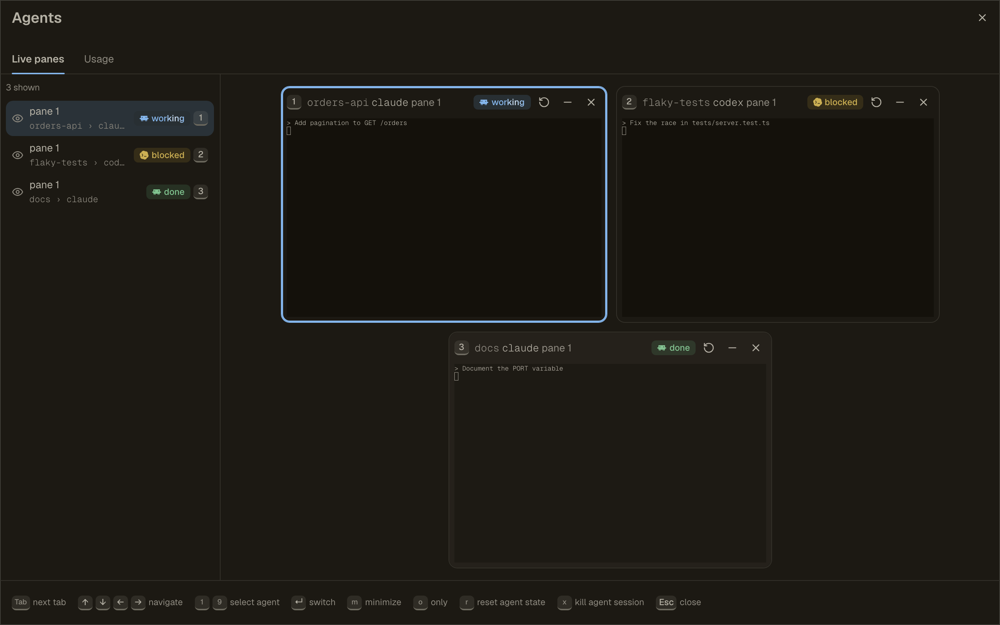

btmux notices Claude Code, Codex, and Gemini CLI running in a pane and tracks
what each is doing, so you can run several and see at a glance which one needs
you.

## Setup

Detection works out of the box: btmux finds the agent's process and reads its
screen. Hooks make it more reliable, and add notifications and completion
messages. Install them once per agent:

```sh
btmux install-claude-code-hooks
btmux install-codex-hooks
btmux install-gemini-cli-hooks
```

Each merges into the agent's own settings file and keeps your other settings.
To see what would be added, use `btmux generate-claude-code-hooks` (or
`-codex-`, `-gemini-cli-`), which prints the JSON instead.

:::note
Codex runs hooks in a shared background daemon, which reports every turn to the
pane that started it. Run `codex --no-daemon` to report to the right pane.
:::

## States

| State       | Meaning                                                       |
| ----------- | ------------------------------------------------------------- |
| **working** | A turn is running                                             |
| **blocked** | Waiting for you: a permission request or a question           |
| **done**    | The turn finished and you haven't looked yet                  |
| **idle**    | Waiting for a prompt                                          |
| **unknown** | An agent is running, but btmux can't tell what it is doing    |

The state appears as a badge on the pane, and the status bar marks windows
with a working agent. `done` becomes `idle` once you view the pane. Work an
agent leaves running between turns, such as Claude Code's background shells,
is shown beside the state: `idle · 2 shells, 1 monitor`.

## Agent view

`<prefix> + a` shows every agent pane on the server as a live tile, with its
session, window, and state.



| Key                  | Action                                          |
| -------------------- | ----------------------------------------------- |
| Arrows, `h` `j` `k` `l` | Move between tiles                           |
| `1`-`9`              | Select an agent                                 |
| `Enter`              | Go to that pane                                 |
| `o`                  | Show only this agent, and back                  |
| `m`                  | Minimize or restore the tile                    |
| `r`                  | Reset the agent's state                         |
| `x`                  | End the agent's session (asks first)            |
| `Tab`                | Switch to the [Usage](usage.md) tab             |
| `Esc`                | Close                                           |

## Notifications

When an agent gets blocked, fails, or finishes, btmux tells you wherever you
are:

- **A dot** on the pane and its window, in every connected client. Viewing the
  pane clears it everywhere.
- **A toast**, unless you are already looking at that pane.
- **An OS notification** while the btmux window is hidden or unfocused. The
  first one offers to enable them, because browsers only grant the permission
  from a click. With several tabs or the desktop app connected, only the one
  you focused most recently notifies.

```toml
[notifications]
os = true
os-level = "attention"   # lowest level shown: info, success, attention, error
```

Your own scripts can notify too, with
[`btmux send-notification`](../automation/notifications.md).

## More

- [Usage](usage.md): tokens, cost, and plan limits per agent.
- [Orchestrating agents](orchestrating.md): prompt agents and wait for them
  from scripts or other agents.
- [Sandboxed sessions](../features/sandbox.md): run agents in a VM that sees
  only one directory.
- [Status detection](detection.md): how states are decided, and how to report
  them yourself.
