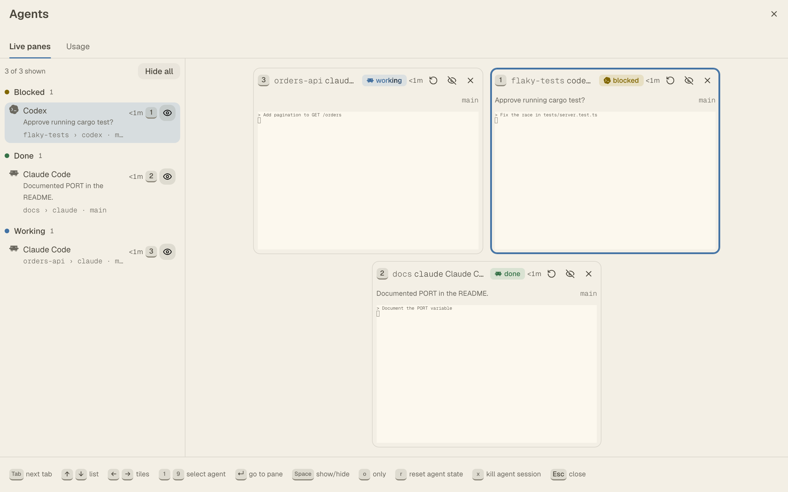

btmux tracks Claude Code, Codex, and Gemini CLI in your panes so you can see
which agents need attention.

<btmux-demo name="agents" label="Demo: three agents in split panes, approving a permission request from the agent view, and jumping to a finished agent"></btmux-demo>

## Setup

btmux detects agents by process and screen. Install hooks once per agent for
more reliable status, notifications, and completion messages.

```sh
btmux install-claude-code-hooks
btmux install-codex-hooks
btmux install-gemini-cli-hooks
```

The installers merge hooks into the agent's settings. To print the JSON, run
the corresponding `generate-*-hooks` command, such as
`btmux generate-claude-code-hooks`.

:::note
Codex runs hooks in a shared background daemon, which reports every turn to the
pane that started it. Run `codex --no-daemon` to report to the right pane.
:::

## States

| State       | Meaning                                                       |
| ----------- | ------------------------------------------------------------- |
| **working** | A turn is running                                             |
| **waiting** | The turn ended, but background work will resume it            |
| **blocked** | Waiting for you: a permission request or a question           |
| **done**    | The turn finished and you haven't looked yet                  |
| **idle**    | Waiting for a prompt                                          |
| **unknown** | An agent is running, but btmux can't tell what it is doing    |

The state appears as a badge on the pane, and the status bar marks windows
with a working agent. `done` becomes `idle` once you view the pane. Work an
agent leaves running between turns, such as Claude Code's background shells,
is shown beside the state. An agent at its prompt with such work is
**waiting**, since it starts again by itself once the work ends: `waiting on
2 shells, 1 monitor`. `btmux wait` and `wait_for_agent` keep waiting through
it.

## Agent view

`<prefix> + a` lists every agent on the server, grouped by state with the most
urgent first: **blocked**, then **done**, **working**, **waiting**, and
**idle**. Within a
group, the agent that has waited longest comes first.

Each row shows the pane title, agent message, time in state, session, window,
and Git branch. Click a row to go to its pane. The eye button opens a live
tile with GitHub status and reported cost. Each client remembers its tiles.




| Key                  | Action                                          |
| -------------------- | ----------------------------------------------- |
| `Up` `Down`, `j` `k` | Move through the list                           |
| `Left` `Right`, `h` `l` | Move between tiles                           |
| `1`-`9`              | Select an agent                                 |
| `Enter`              | Go to that pane                                 |
| `Space`              | Show or hide its tile                           |
| `o`                  | Show only this agent's tile, and back to all    |
| `r`                  | Reset the agent's state                         |
| `x`                  | End the agent's session (asks first)            |
| `Tab`                | Switch to the [Usage](usage.md) tab             |
| `Esc`                | Close                                           |

## Notifications

btmux notifies you when an agent gets blocked, fails, or finishes. A turn
that ends with background work running notifies only if the agent doesn't
start again by itself: while it is **waiting**, the notification is held (up
to 10 minutes), and the turn it resumes notifies instead.

- **A dot** on the pane and its window, in every connected client. Viewing the
  pane clears it everywhere.
- **A toast**, unless you are already looking at that pane.
- **An OS notification** while the btmux window is hidden or unfocused. The
  first one offers to enable them, because browsers only grant the permission
  from a click. With several tabs or the desktop app connected, only the one
  you focused most recently notifies.

```toml
[notifications]
os = true
os-level = "attention"   # lowest level shown: info, success, attention, error
```

Your own scripts can notify too, with
[`btmux send-notification`](../automation/notifications.md).

## More

- [Track tokens, cost, and plan limits](usage.md)
- [Prompt agents from scripts](orchestrating.md)
- [Run agents in a sandbox](../features/sandbox.md)
- [Inspect or report agent state](detection.md)
