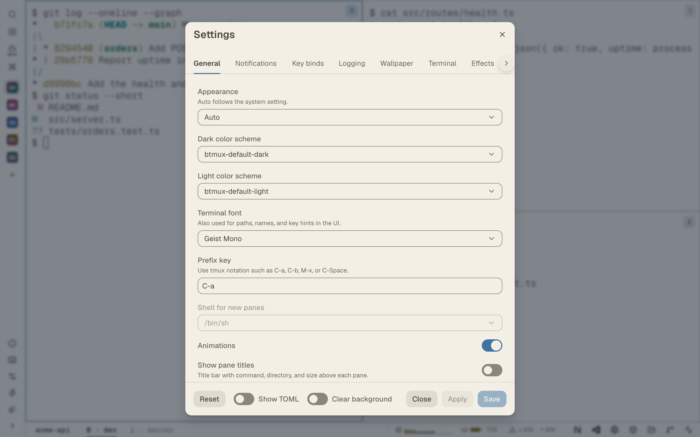

btmux reads one TOML file, created on first launch:

```text
~/.config/btmux/config.toml
```

It follows `$XDG_CONFIG_HOME`; on Windows it is `%APPDATA%\btmux\config.toml`.
Every field is optional. `btmux generate-config` prints them all with their
defaults, as does [All options](reference.md).

```toml
prefix = "C-b"
editor = "pane"

[terminal]
font-family = "JetBrains Mono"
font-size = 16
```

## Changes apply live

Saving the file updates every connected client. A few options are read only
when something starts: log levels at server start, `[vscode] server` when VS
Code starts, and most of `[multipass]` when the VM is created.

If the file can't be parsed, btmux keeps the last valid configuration and
shows a banner until it is fixed. The banner's **Show error** button opens the
full message.

## Settings

Press `<prefix> + :` and choose `config: open settings` to edit most options in
a dialog, with live previews. **Apply** changes the running server only, to try
things out: such changes are dropped on restart and whenever `config.toml`
reloads. **Save** writes them to `config.toml`, keeping your comments and other
settings. If the file is read-only, as Nix and Home Manager install it, the
dialog shows the TOML to copy instead.




The command palette's color and font pickers work like Apply.

## Updates

btmux checks GitHub for newer releases about once a day and shows a toast when
one is available. It never downloads or installs anything:
[upgrade](../start/installation.mdx#upgrading) with whatever you installed
with. Set `check-for-updates = false` to turn the check off.

## Where things are set

| To change                         | See                                          |
| --------------------------------- | -------------------------------------------- |
| The prefix and key bindings       | [Key bindings](keybindings.md)               |
| Colors, fonts, wallpapers         | [Appearance](../features/appearance.md)      |
| What `<prefix> + e` opens         | [Editors](../features/editors.md)            |
| The sandbox VM                    | [Sandboxed sessions](../features/sandbox.md) |
| Notifications                     | [Coding agents](../agents/index.md#notifications) |
| Separate servers and saved state  | [Profiles](profiles.md)                      |
| Server flags and every command    | [All commands](commands.md)                  |
