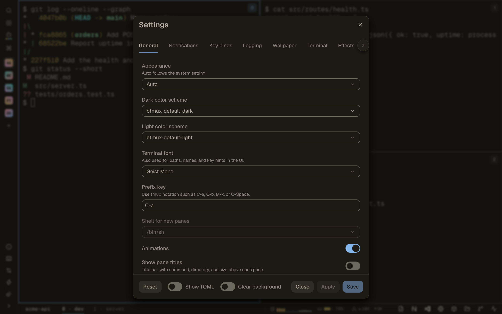

btmux reads one TOML file, created on first launch:

```text
~/.config/btmux/config.toml
```

It follows `$XDG_CONFIG_HOME`; on Windows it is `%APPDATA%\btmux\config.toml`.
Every field is optional. `btmux generate-config` prints them all with their
defaults, as does [All options](reference.md).

```toml
prefix = "C-b"
editor = "pane"

[terminal]
font-family = "JetBrains Mono"
font-size = 16
```

## Changes apply live

Saving updates every connected client. Log levels apply at server startup,
`[vscode] server` when VS Code starts, and most of `[multipass]` when btmux
creates the VM.

If the file can't be parsed, btmux keeps the last valid configuration and
shows a banner until it is fixed. The banner's **Show error** button opens the
full message.

## Settings

Press `<prefix> + :` and choose `config: open settings` for live previews.
**Apply** changes the running server until it restarts or reloads
`config.toml`. **Save** edits the file and preserves comments and other
settings. If the file is read-only, the dialog shows TOML you can copy.
To find a setting, type its name: the search field above the tabs lists
matches from every tab.




The command palette's color and font pickers work like Apply.

## Updates

btmux checks GitHub about once a day and shows a toast when an update is
available. See [Upgrading](../start/installation.mdx#upgrading). Set
`check-for-updates = false` to disable checks.

## Where things are set

| To change                         | See                                          |
| --------------------------------- | -------------------------------------------- |
| The prefix and key bindings       | [Key bindings](keybindings.md)               |
| Colors, fonts, wallpapers         | [Appearance](../features/appearance.md)      |
| What `<prefix> + e` opens         | [Editors](../features/editors.md)            |
| The sandbox VM                    | [Sandboxed sessions](../features/sandbox.md) |
| Notifications                     | [Coding agents](../agents/index.md#notifications) |
| Separate servers and saved state  | [Profiles](profiles.md)                      |
| Server flags and every command    | [All commands](commands.md)                  |
