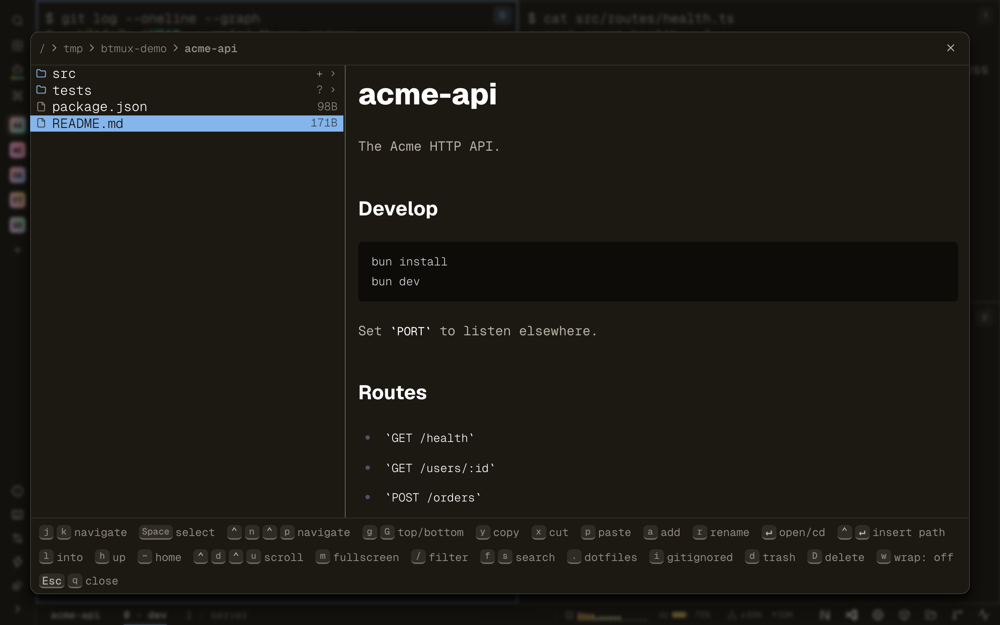
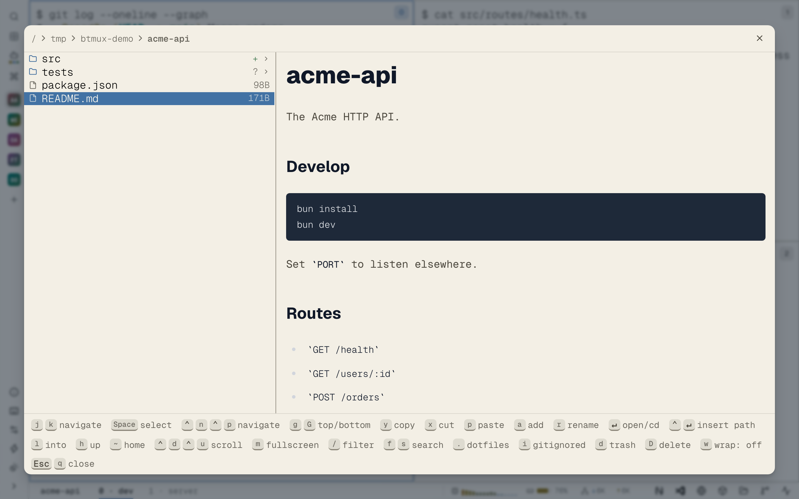
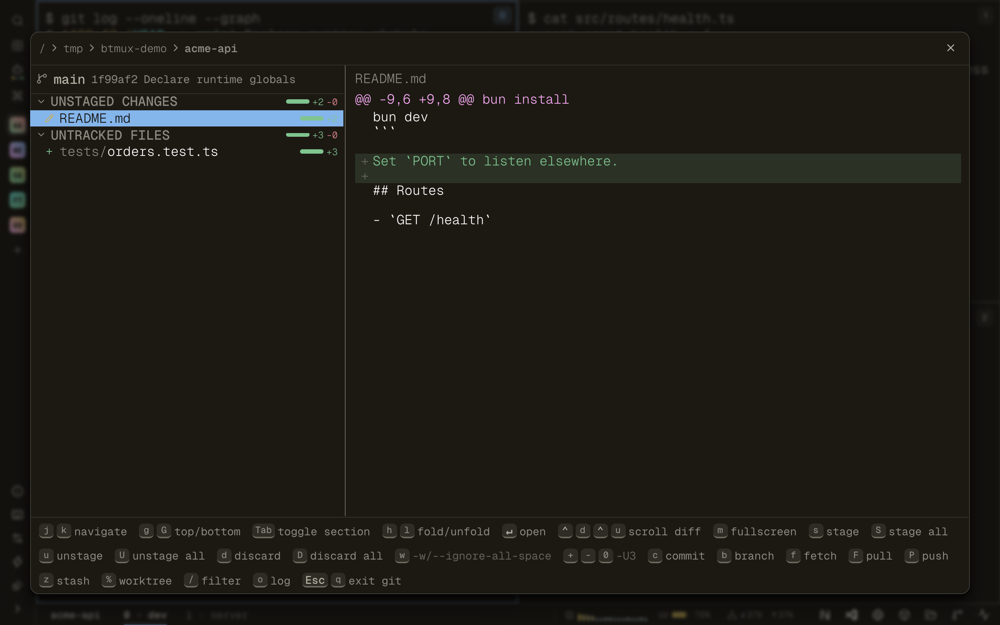
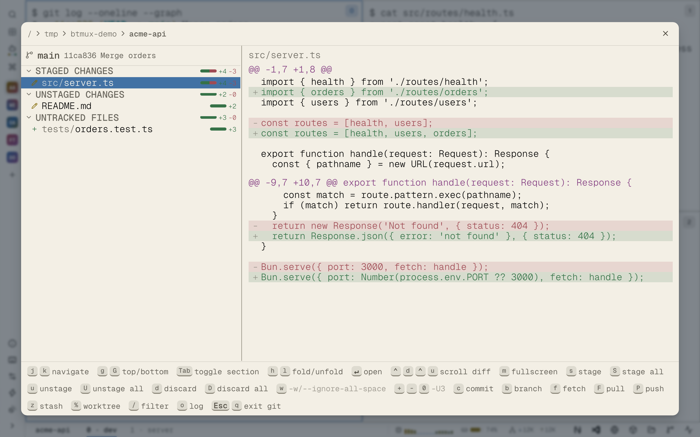

Browse files or manage Git from the active pane's directory. The dialog
footer lists the available keys.

<btmux-demo name="files" label="Demo: the file browser's filter, file search, and content search, then Git mode"></btmux-demo>

## File browser

`<prefix> + f` opens the file browser with a preview of the selected entry.




| Key                         | Action                                                 |
| --------------------------- | ------------------------------------------------------ |
| `j` / `k`, arrows           | Move                                                   |
| `g` / `G`                   | First / last entry                                     |
| `l`, Right                  | Enter a directory                                      |
| `h`, Left, Backspace        | Parent directory                                       |
| `~`                         | Home                                                   |
| `Enter`                     | Open a file in the [editor](editors.md), or `cd` the pane to a directory |
| `Ctrl+Enter`                | Type the path into the pane                            |
| `/`                         | Filter this directory by name                          |
| `f` / `s`                   | Search file names / file contents below this directory |
| `.` / `i`                   | Show dotfiles / gitignored files                       |
| `Space`                     | Select several entries                                 |
| `y` / `x` / `p`             | Copy / cut / paste                                     |
| `a`                         | New file or folder (end the name with `/` for a folder) |
| `r`                         | Rename                                                 |
| `d` / `D`                   | Move to trash / delete permanently (asks first)        |
| `Ctrl+D` / `Ctrl+U`         | Scroll the preview                                     |
| `m`, `w`                    | Preview fullscreen, wrap lines                         |
| `q`, `Esc`                  | Close                                                  |

Previews cover code with syntax highlighting, Markdown, JSON, CSV, images,
PDF, video, audio, and HTML (rendered without scripts; `v` shows the source).
A directory previews as a tree. Binary files open with the server machine's
default app instead of the editor.

Name search uses `fd` and content search uses `rg` when they are installed,
falling back to `find` and `grep`. Both show at most 100 results. Searches
and filters here, as elsewhere in btmux, ignore case unless the query has an
uppercase letter.

## Git mode

`<prefix> + g` opens the pane's Git status and shows the selected file's diff.




| Key                 | Action                                              |
| ------------------- | --------------------------------------------------- |
| `s` / `u`           | Stage / unstage the file (on a header: the section) |
| `S` / `U`           | Stage / unstage everything                          |
| `d` / `D`           | Discard the file's changes / all unstaged changes (asks first) |
| `c`                 | Commit: subject and body, `Ctrl+Enter` to confirm   |
| `Enter`             | Open the file in the editor, at the first change    |
| `o`                 | Log: the latest 200 commits with their diffs; `s` returns |
| `w`                 | Ignore whitespace in diffs                          |
| `+` / `-` / `0`     | More / fewer / default context lines                |
| `/`                 | Filter files, or commits in the log                 |
| `Tab`, `h` / `l`    | Fold and unfold sections                            |
| `q`, `Esc`          | Close                                               |

### Branches, remotes, stashes

As in Magit, one key opens a popup and a second runs an action. In the fetch,
pull, push, and stash popups, `-` followed by a letter toggles a flag first.

| Key | Popup    | Actions                                                                 | Flags |
| --- | -------- | ----------------------------------------------------------------------- | ----- |
| `b` | Branch   | `Enter` check out, `c` create and check out, `n` create, `m` rename, `d` delete, `D` force delete | |
| `f` | Fetch    | `u` upstream, `e` another remote, `a` all remotes                        | `-p` prune, `-t` tags |
| `F` | Pull     | `u` upstream, `e` another branch                                         | `-r` rebase, `-f` fast-forward only |
| `P` | Push     | `u` upstream, `e` elsewhere, `t` tags                                    | `-f` force with lease, `-h` skip hooks, `-n` dry run |
| `z` | Stash    | `z` stash, `i` index only, `a` apply, `p` pop, `d` drop                  | `-u` untracked, `-a` all |
| `%` | Worktree | `Enter` visit, `c` create and visit, `n` create, `d` delete, `D` force delete, `l` lock, `p` prune | |

These run the `git` command, so your credentials, hooks, and config apply.

## Worktrees

A worktree gives a branch its own directory, which suits running one agent per
branch.

- `<prefix> + W` asks for a branch and opens a window in a new worktree for
  it. An existing local or remote branch is checked out; otherwise the branch
  starts at the pane's HEAD.
- `<prefix> + X` removes the pane's worktree and closes its panes. The branch
  is kept. It refuses the main worktree, uncommitted changes, a locked
  worktree, and panes still running a program. The worktree popup's `D` forces
  it.

Worktrees are created beside the repository as `<repo>-<branch>`. Change that
with `worktree-path`:

```toml
worktree-path = "~/worktrees/{repo}/{branch}"
```

The [session switcher](../start/first-steps.md#sessions) colors sessions by
repository, shows each window's branch, and marks branches that are ahead,
behind, or have changes.

## GitHub status

The pane's GitHub badge shows the pull request, review status, and check
counts. Click it to open the PR or, if there's none, the branch.

Install the [GitHub CLI](https://cli.github.com) and run `gh auth login`.
btmux fetches status through `gh`.

```toml
[github]
enabled = true
hosts = ["github.example.com"]   # GitHub Enterprise hosts to ask too
```
