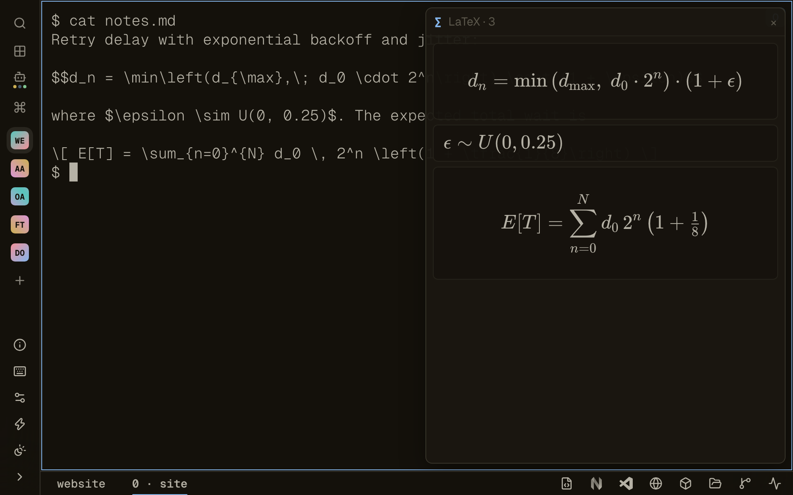
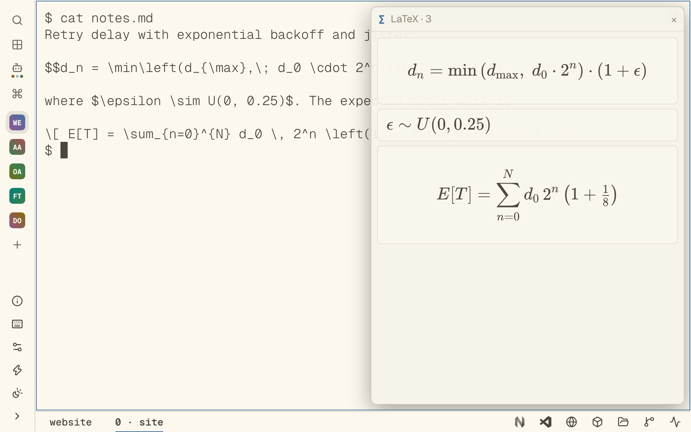

The LaTeX overlay renders formulas from the visible pane in a KaTeX side
panel. Open it with `<prefix> + m`, `latex: toggle overlay`, or the `∑ N`
button that appears when btmux finds formulas. The button sits in the title
bar or the pane's top-right corner.

btmux recognizes `$$…$$`, `\[…\]`, `\(…\)`, `$…$`, and environments like
`\begin{equation}`. It also detects bare `[` / `]` blocks and `( … )` spans
from coding agents.

<btmux-demo name="latex" label="Demo: an agent's LaTeX rendered in the side panel, with each formula's source highlighted on hover"></btmux-demo>

Hovering a formula highlights its source in the terminal. Rebind the key with
`toggle-latex` under `[keys]`.

Detection is heuristic. Shell text such as `$HOME/bin:$PATH` is filtered out,
and anything KaTeX cannot parse is dropped silently.
