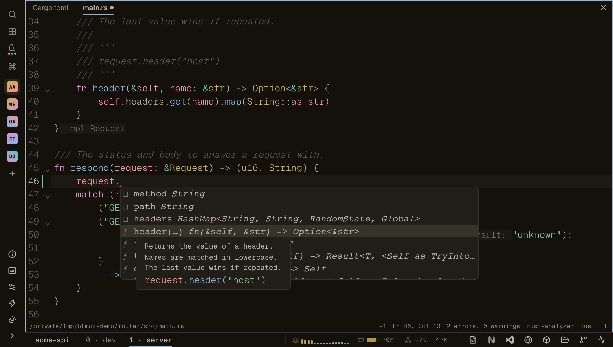

`<prefix> + e` opens the native editor by default. Each pane can have its
own [editor tabs](editors.md#over-a-pane). Clients share files and edits live.
Unsaved changes survive a client reload and
[`btmux upgrade`](../internals/upgrade.md). The editor reloads files changed
on disk or warns you if there are unsaved edits.

<btmux-demo name="editor" label="Demo: opening a file from the shell, quick open, a completion from rust-analyzer, and saving"></btmux-demo>




| Key              | Does                                              |
| ---------------- | ------------------------------------------------- |
| `Mod-s`          | Saves                                             |
| `Mod-p`          | Quick open: finds a file under the pane's folder  |
| `Alt-w`          | Closes the file, asking to save unsaved changes   |
| Esc twice        | Hides the editor                                  |

Mod is Cmd on macOS and Ctrl elsewhere. Quick open starts with open and
recent files. Append `:42` to open a file at line 42, or enter `:42` alone
to jump there in the current file.


## Vim mode

`[native-editor] vim = true`, also in Settings, adds Vim keybindings
([codemirror-vim](https://github.com/replit/codemirror-vim)). It applies to
open editors at once.

- The status line shows the mode, and normal mode has a block cursor.
- `:w` saves (`:w!` overwrites changes made on disk), `:q` hides the editor
  and keeps unsaved changes, `:wq` or `:x` saves and hides it, and `:bd`
  closes the file (`:bd!` discards unsaved changes).
- A double Esc hides the editor only from normal mode with no command pending,
  so leaving insert mode never hides it.
- With a language server, `gd` goes to the definition, `K` shows the hover,
  and `]d` and `[d` move between diagnostics.
- Ctrl chords such as `Ctrl-d`, `Ctrl-o`, and `Ctrl-v` go to Vim, except the
  btmux prefix and shortcuts the browser keeps (such as Ctrl-W outside macOS).
- Mode and registers are per client; edits are shared as always.
- On macOS, holding `h` `j` `k` `l` in a browser opens the accent menu
  instead of repeating; see
  [Key repeat on macOS](/configuration/keybindings/#key-repeat-on-macos).

## Language servers

The editor shares one instance of each language server per project root across
clients. The root is the outermost directory in the Git worktree with a marker
for that language, such as `Cargo.toml`. The status line shows server state
and progress.

btmux searches its own `PATH` and then your shell's `PATH`. Preconfigured
servers include rust-analyzer, typescript-language-server,
pyright, gopls, clangd, lua-language-server, nil (Nix), bash-language-server,
taplo (TOML), just-lsp (justfiles), yaml-language-server, and
vscode-langservers-extracted (JSON, CSS, HTML). The About dialog's Health tab
lists each configured server and whether btmux found it.

Add or replace languages and servers in `config.toml`:

```toml
[[language]]
name = "python"
file-types = ["py", "pyi"]
roots = ["pyproject.toml", "setup.py"]
language-servers = ["basedpyright"]

[language-server.basedpyright]
command = "basedpyright-langserver"
args = ["--stdio"]
config = { basedpyright = { analysis = { typeCheckingMode = "strict" } } }
```

`file-types` are extensions; `file-names` are whole names, such as
`Makefile`, matched ignoring case. `config` answers the server's
`workspace/configuration` requests. Changes
apply to servers started afterward. nil releases since 2025-06-13 format with
nixfmt by default (Nixpkgs builds in its own); for older ones, or another
formatter, set `config = { nil = { formatting = { command = ["alejandra"] } } }`
under `[language-server.nil]`, along with `command = "nil"`. Files in a
[sandboxed session](sandbox.md)'s mounts get their servers inside the VM.

Diagnostics, semantic highlighting, inlay hints, code lenses, folding, and
completion with signature help need no keys. The rest:

| Feature                                    | Keys                                 |
| ------------------------------------------ | ------------------------------------ |
| Hover                                      | The mouse                            |
| Go to definition                           | `F12`, or Cmd-click (Ctrl-click elsewhere) |
| References                                 | `Shift-F12`                          |
| Rename, across files                       | `F2`                                 |
| Code actions                               | `Mod-.`                              |
| Symbols in the file                        | `Mod-Shift-O`                        |
| Symbols in the workspace                   | `Mod-Alt-O`                          |
| Calls to the symbol                        | `Shift-Alt-H`                        |
| Grow the selection to the enclosing syntax | `Mod-I` (`Mod-U` shrinks it)         |
| Format the document or the selection       | `Shift-Alt-F`                        |

`[native-editor] format-on-save = true` formats on every save. Renames and
code actions also change files that aren't open: those wait in the editor,
unsaved, under "Other unsaved files".

## Git signs

Git signs mark changes from the index. Following
[gitsigns.nvim](https://github.com/lewis6991/gitsigns.nvim), green marks
additions, blue marks edits, and red marks deletions. Signs and status line
counts update as you edit or stage. Click a sign to preview, stage, or reset
its hunk.

| Action                                    | Keys                      | Vim           |
| ----------------------------------------- | ------------------------- | ------------- |
| Next or previous hunk                     | `Alt-F5` / `Shift-Alt-F5` | `]c` / `[c`   |
| Preview the hunk                          | Click its sign            | `\hp`         |
| Stage the hunk, or the selection's hunks  |                           | `\hs`         |
| Reset the hunk to the index               |                           | `\hr`         |
| Stage or reset the whole buffer           |                           | `\hS` / `\hR` |
| Blame the line, with the commit message   |                           | `\hb`         |
| Toggle blame at the end of the cursor line |                          | `\tb`         |
| The hunk as a text object (`dih`, `vih`)  |                           | `ih`          |

Staging writes the buffer's text to the index, saved or not. Resetting edits
the buffer, so undo brings the change back.

## Actions

The command palette has every command on this page as an `editor-*` action,
such as `editor-quick-open`, `editor-stage-hunk`, and
`editor-toggle-line-blame`, plus the symbol's outgoing calls, supertypes, and
subtypes. They are unbound by default; bind them in
[`[keys]`](../configuration/keybindings.md).
