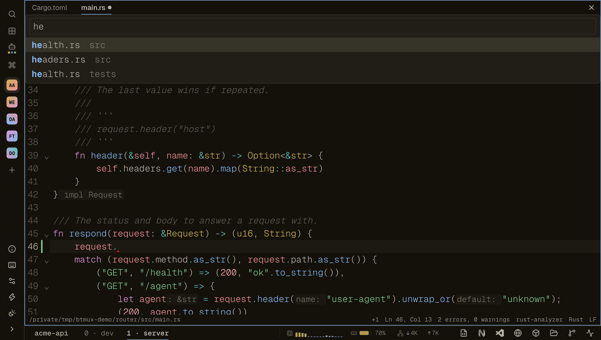
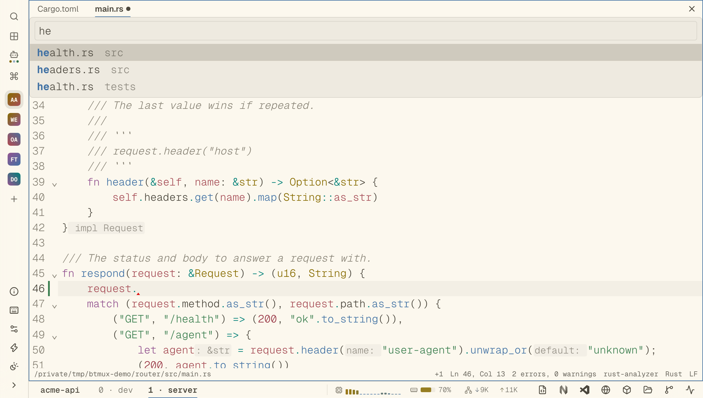

`<prefix> + e` opens the native editor by default. Each pane can have its
own [editor tabs](editors.md#over-a-pane). Clients share files and edits live.
Unsaved changes survive a client reload and
[`btmux upgrade`](../internals/upgrade.md). The editor reloads files changed
on disk or warns you if there are unsaved edits.

<btmux-demo name="editor" label="Demo: opening a file from the shell, quick open, a completion from rust-analyzer, and saving"></btmux-demo>


Keys follow VS Code's defaults. These are the ones to know first:

| Key                           | Does                                                        |
| ----------------------------- | ----------------------------------------------------------- |
| `Mod-s`                       | Saves                                                       |
| `Mod-p`                       | Quick open: finds a file under the pane's folder            |
| `Mod-f`                       | Finds and replaces in the file                              |
| `Alt-w`                       | Closes the file, asking to save unsaved changes             |
| `Alt-PageDown` / `Alt-PageUp` | Shows the next or previous open file                        |
| `Ctrl--` / `Ctrl-Shift--`     | Goes back or forward to where you jumped from, across files |
| `Ctrl-g`                      | Goes to a line                                              |
| `Mod-Shift-Enter`             | Inserts a line above                                        |
| `Mod-d` / `Mod-F2`            | Selects the next or every occurrence of the word            |
| `Mod-k`, then another key     | VS Code's chords; a popup lists them, and other keys type   |
| Esc twice                     | Hides the editor                                            |

`<prefix> + ?` lists every key the editor has, in its Editor tab, and the
command palette shows each editor command's keys beside it. Both follow Vim
mode and your own mappings.

Mod is Cmd on macOS and Ctrl elsewhere. Go back and forward are `Alt-←` and
`Alt-→` on Windows, and `Ctrl-Alt--` and `Ctrl-Shift--` on Linux. Browsers
keep `Mod-w` and `Mod-t`, so the editor takes them only in the desktop app:
`Mod-w` closes the file there, and Close Window moves to `Cmd-Shift-W`.
Browsers also keep VS Code's keys for the next and previous file, which the
desktop app adds: `Ctrl-Tab` and `Ctrl-Shift-Tab`, and `Cmd-Alt-→` and
`Cmd-Alt-←` on macOS or `Ctrl-PageDown` and `Ctrl-PageUp` elsewhere.

In find and replace, `Enter` goes to the next match and `Shift-Enter` to the
previous one; `Alt-Enter` selects every match. In the replace field, `Enter`
replaces the next match and `Mod-Alt-Enter` replaces them all. The buttons
beside the find field match case, whole words, or a regular expression.

Each tab has an X that closes it, shown on the active tab and on hover; on a
tab with unsaved changes, a dot takes its place until you hover. A middle
click closes a tab too, and so does `Delete` on a focused tab.

Quick open starts with open and recent files. Append `:42` to open a file at
line 42, or enter `:42` alone to jump there in the current file.

In the completion menu, quick open, and other pickers, `Ctrl-n` and `Ctrl-p`
move down and up, as in Vim, and so do `Ctrl-j` and `Ctrl-k`, as in fzf.
Off macOS, browsers keep `Ctrl-n` for a new window, so use `Ctrl-j` there;
the desktop app gets both. While completions are open, these keys move in
them rather than opening quick open or starting a `Mod-k` chord.




## Vim mode

`[native-editor] vim = true`, also in Settings, adds Vim keybindings
([codemirror-vim](https://github.com/replit/codemirror-vim)). It applies to
open editors at once.

- The status line shows the mode, and the keys of a command you haven't
  finished.
- `:w` saves (`:w!` overwrites changes made on disk), `:q` hides the editor
  and keeps unsaved changes, `:wq` or `:x` saves and hides it, and `:bd`
  closes the file (`:bd!` discards unsaved changes). `:bn` and `:bp` show
  the next and previous open file.
- A double Esc hides the editor only from normal mode with no command pending,
  so leaving insert mode never hides it.
- Ctrl chords such as `Ctrl-d` and `Ctrl-v` go to Vim, except the btmux
  prefix and shortcuts the browser keeps (such as Ctrl-W outside macOS, so
  `<C-w>d` works only there and in the desktop app).
- Mode and registers are per client; edits are shared as always.
- On macOS, holding `h` `j` `k` `l` in a browser opens the accent menu
  instead of repeating; see
  [Key repeat on macOS](/configuration/keybindings/#key-repeat-on-macos).

### Mappings

Vim predates language servers, so these follow Neovim's own defaults where it
has them, and otherwise what most Neovim configurations use
([kickstart.nvim](https://github.com/nvim-lua/kickstart.nvim),
[gitsigns.nvim](https://github.com/lewis6991/gitsigns.nvim)). `<leader>` is
Space.

| Keys                       | Does                                         |
| -------------------------- | -------------------------------------------- |
| `gd`, `Ctrl-]` / `gD`      | Goes to the definition / declaration         |
| `K`                        | Shows the hover                              |
| `grn`                      | Renames, across files                        |
| `gra`                      | Code actions, also for a visual selection    |
| `grr`                      | References                                   |
| `gri` / `grt`              | Goes to the implementation / type definition |
| `grx`                      | Runs the code lens on the line               |
| `gO` / `gW`                | Symbols in the file / workspace              |
| `an` / `in` in visual mode | Grows / shrinks the selection                |
| `gq` with a motion         | Formats, or wraps lines without a server     |
| `<leader>f`                | Formats the file, or the visual selection    |
| `]d` / `[d`, `]D` / `[D`   | Next / previous diagnostic, last / first     |
| `<C-w>d`                   | Shows the diagnostics on the line            |
| `Ctrl-o` / `Ctrl-i`        | Goes back / forward, across files            |
| `gt` / `gT`, `]b` / `[b`   | Next / previous open file                    |

The [Git signs](#git-signs) mappings start with `<leader>h`. Neovim's
insert-mode `Ctrl-s` (signature help) isn't mapped, as `Ctrl+S` saves outside
macOS; signature help shows as you type a call, or with `Mod-Shift-Space`.

### Which keys come next

Pause after the start of a mapping, such as the leader or `g`, and a popup
lists the keys that can follow and what they do, as
[which-key.nvim](https://github.com/folke/which-key.nvim) does. It also lists
Vim's own keys after `g`, `z`, `[`, and `]`, motions and text objects after an
operator such as `d`, and the registers after `"`. Esc drops the keys typed so
far. `[native-editor] which-key = false` turns the popup off.

### Your own mappings

Map keys to any btmux action (the `editor-*` ones below, or any in
[`[keys]`](../configuration/keybindings.md)), or to other keys:

```toml
[native-editor]
leader = ","

[native-editor.vim-keys]
"<leader>ff" = "editor-quick-open"
"<leader>d" = { action = "editor-problems", desc = "Problems" }
"<leader>f" = { action = "editor-format", modes = ["normal", "visual"] }
"<C-h>" = "navigate-left"
"jk" = { keys = "<Esc>", modes = ["insert"] }
"gd" = "none"

[native-editor.vim-groups]
"<leader>f" = "find"
```

| Setting      | Does                                                                 |
| ------------ | -------------------------------------------------------------------- |
| `leader`     | The key `<leader>` stands for: Space by default, or one key like `,` |
| `vim-keys`   | Keys in Vim notation, mapped to an action, a table, or `"none"`      |
| `modes`      | `normal` (the default), `visual`, `insert`                           |
| `desc`       | What the popup shows; the action's name by default                   |
| `keys`       | Keys Vim gets instead of an action                                   |
| `"none"`     | Removes the default mapping on those keys                            |
| `vim-groups` | The name the popup shows for keys that start several mappings        |
| `timeout`    | How long a mapping that starts a longer one waits, in ms (1000)      |

Keys are written as in Vim: `<C-w>`, `<A-x>` (Alt), `<D-k>` (Cmd), `<S-Tab>`,
`<Space>`, `<CR>`, `<Esc>`. An action in insert mode needs a key that types
nothing, such as `<C-k>`; map typed keys like `jk` with `keys`.

Keys that start a mapping wait for the rest, as in Vim. When the next key
doesn't continue one, the longest mapping among the keys runs and the rest
are mapped again; keys no mapping starts with go to Vim, so `gg` and `viw`
still work. A mapping that also starts a longer one, such as `<leader>h`
beside `<leader>hs`, runs once no key follows within `timeout`. A Vim command
the leader shadows (with `,`, repeating `f` backward) runs only when the next
key isn't mapped. Esc drops keys typed so far, so it can't be mapped.

## Language servers

The editor shares one instance of each language server per project root across
clients. The root is the outermost directory in the Git worktree with a marker
for that language, such as `Cargo.toml`. The status line shows each server
with a dot. Hover, focus, or tap it for details; narrow panes keep only the
dot. With `animations = false`, dots don't pulse.

| Dot          | Server                                                                                           |
| ------------ | ------------------------------------------------------------------------------------------------ |
| Green        | Ready                                                                                            |
| Pulsing blue | Working, such as indexing                                                                        |
| Pulsing gray | Starting                                                                                         |
| Yellow       | Not responding: a request is unanswered and it sent nothing since, for longer than its `timeout` |
| Red          | Failed: not found, silent for its `timeout` while starting, or crashed 3 times in a minute       |

A server that isn't responding goes back to green once it sends anything.

btmux searches its own `PATH` and then your shell's `PATH`. Preconfigured
servers include rust-analyzer, typescript-language-server, ty and ruff
(Python), gopls, clangd, lua-language-server, nil (Nix), bash-language-server,
taplo (TOML), just-lsp (justfiles), yaml-language-server, and
vscode-langservers-extracted (JSON, CSS, HTML), and rumdl and harper-ls
(Markdown: rumdl lints, formats, and follows links; harper-ls checks spelling
and grammar). The About dialog's Health tab
lists each configured server and whether btmux found it.

A file can have several servers, as Python has ty for types, completions,
and navigation and ruff for linting and formatting. Each gives its own
diagnostics, code actions, hovers, inlay hints, code lenses, and completions.
Everything else, such as formatting and go to definition, comes from the
first server listed that can do it. Signature help and the references panel
come from the first server, and references from a later one show in a
picker. A server that isn't installed or fails is left out, so the next one
takes its place.

Add or replace languages and servers in `config.toml`:

```toml
[[language]]
name = "python"
file-types = ["py", "pyi"]
roots = ["pyproject.toml", "setup.py"]
language-servers = ["basedpyright"]

[language-server.basedpyright]
command = "basedpyright-langserver"
args = ["--stdio"]
config = { basedpyright = { analysis = { typeCheckingMode = "strict" } } }
```

`file-types` are extensions; `file-names` are whole names, such as
`Makefile`, matched ignoring case. `config` answers the server's
`workspace/configuration` requests. `timeout` (seconds, default 20) is how
long a server may stay silent while starting or on a request; 0 turns these
checks off. Changes
apply to servers started afterward. nil releases since 2025-06-13 format with
nixfmt by default (Nixpkgs builds in its own); for older ones, or another
formatter, set `config = { nil = { formatting = { command = ["alejandra"] } } }`
under `[language-server.nil]`, along with `command = "nil"`. Files in a
[sandboxed session](sandbox.md)'s mounts get their servers inside the VM.

rumdl runs with its default rules and ignores `.rumdl.toml` and other
project config files, since they can name commands rumdl runs on code blocks
when a file opens. For repositories you trust, replace it with a table that
lets rumdl read them:

```toml
[language-server.rumdl]
command = "rumdl"
args = ["server"]
```

Diagnostics, semantic highlighting, inlay hints, code lenses, folding, and
completion with signature help need no keys. The rest:

| Feature                                | Keys                                                                 |
| -------------------------------------- | -------------------------------------------------------------------- |
| Hover                                  | The mouse, or `Mod-K Mod-I`                                          |
| Go to definition                       | `F12`, or Cmd-click (Ctrl-click elsewhere)                           |
| References                             | `Shift-F12`                                                          |
| Rename, across files                   | `F2`                                                                 |
| Code actions                           | `Mod-.`                                                              |
| Symbols in the file                    | `Mod-Shift-O`                                                        |
| Symbols in the workspace               | `Mod-Alt-O`, or `Mod-T` in the desktop app                           |
| Calls to the symbol                    | `Shift-Alt-H`                                                        |
| Grow or shrink the selection by syntax | `Ctrl-Shift-Cmd-→` / `←` (`Shift-Alt-→` / `←` elsewhere), or `Mod-I` |
| Next or previous problem               | `F8` / `Shift-F8`                                                    |
| All problems                           | `Mod-Shift-M`                                                        |
| Format the document or the selection   | `Shift-Alt-F`; `Mod-K Mod-F` the selection                           |
| Fold or unfold everything              | `Mod-K Mod-0` / `Mod-K Mod-J`                                        |

Diagnostics are underlined, and hovering one shows its message. With
`[native-editor] virtual-text = true`, also in Settings as **Inline
diagnostics**, each line's most severe error, warning, or info also shows at
the end of the line, with a count of the others. Hints don't, since they
mostly fade unused code.

`[native-editor] format-on-save = true` formats on every save. Renames and
code actions also change files that aren't open: those wait in the editor,
unsaved, under "Other unsaved files".

## Git signs

Git signs mark changes from the index. Following
[gitsigns.nvim](https://github.com/lewis6991/gitsigns.nvim), green marks
additions, blue marks edits, and red marks deletions. Signs and status line
counts update as you edit or stage. Click a sign to preview, stage, or reset
its hunk.

| Action                                     | Keys                      | Vim                         |
| ------------------------------------------ | ------------------------- | --------------------------- |
| Next or previous hunk                      | `Alt-F5` / `Shift-Alt-F5` | `]c` / `[c`                 |
| Preview the hunk                           | Click its sign            | `<leader>hp`                |
| Stage the hunk, or the selection's hunks   |                           | `<leader>hs`                |
| Reset the hunk to the index                |                           | `<leader>hr`                |
| Stage or reset the whole buffer            |                           | `<leader>hS` / `<leader>hR` |
| Blame the line, with the commit message    |                           | `<leader>hb`                |
| Toggle blame at the end of the cursor line |                           | `<leader>tb`                |
| The hunk as a text object (`dih`, `vih`)   |                           | `ih`                        |

Staging writes the buffer's text to the index, saved or not. Resetting edits
the buffer, so undo brings the change back.

## Actions

The command palette has every command on this page as an `editor-*` action,
shown with the keys that run it in the editor. They include
`editor-quick-open`, `editor-go-to-definition`, `editor-format`,
`editor-stage-hunk`, and `editor-go-back`, plus the symbol's outgoing calls,
supertypes, and subtypes. Bind them after the prefix in
[`[keys]`](../configuration/keybindings.md), or in Vim mode in
[`vim-keys`](#your-own-mappings).
