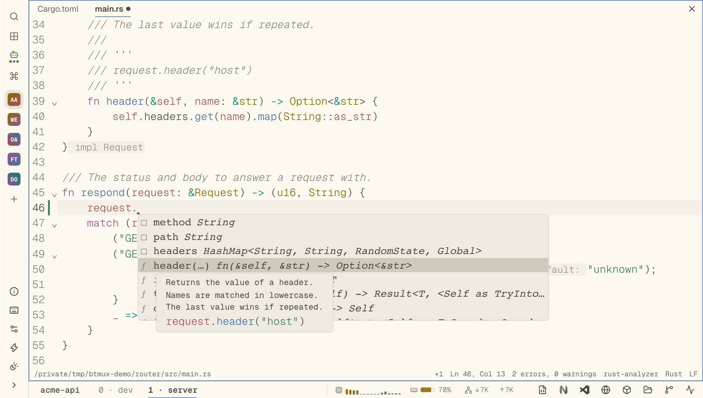

The native editor is btmux's own editor and the default for `<prefix> + e`. It
opens [over a pane](editors.md#over-a-pane), with that pane's open files as
tabs, and any number of panes can have one.

Every client shows the same files and edits the same text, live. Unsaved
changes live on the server, so they survive a reload and a
[`btmux upgrade`](../internals/upgrade.md). A file changed on disk reloads,
unless you have unsaved changes, which get a warning instead.




| Key              | Does                                              |
| ---------------- | ------------------------------------------------- |
| `Mod-s`          | Saves                                             |
| `Mod-p`          | Quick open: finds a file under the pane's folder  |
| `Alt-w`          | Closes the file, asking to save unsaved changes   |
| Esc twice        | Hides the editor                                  |

Mod is Cmd on macOS and Ctrl elsewhere. With nothing typed, quick open lists
the pane's open files, then recent ones. A trailing `:42` opens the file on
that line; `:42` alone moves in the current file.


## Vim mode

`[native-editor] vim = true`, also in Settings, adds Vim keybindings
([codemirror-vim](https://github.com/replit/codemirror-vim)). It applies to
open editors at once.

- The status line shows the mode, and normal mode has a block cursor.
- `:w` saves (`:w!` overwrites changes made on disk), `:q` hides the editor
  and keeps unsaved changes, `:wq` or `:x` saves and hides it, and `:bd`
  closes the file (`:bd!` discards unsaved changes).
- A double Esc hides the editor only from normal mode with no command pending,
  so leaving insert mode never hides it.
- With a language server, `gd` goes to the definition, `K` shows the hover,
  and `]d` and `[d` move between diagnostics.
- Ctrl chords such as `Ctrl-d`, `Ctrl-o`, and `Ctrl-v` go to Vim, except the
  btmux prefix and shortcuts the browser keeps (such as Ctrl-W outside macOS).
- Mode and registers are per client; edits are shared as always.

## Language servers

The editor starts a language server for each file it opens, one per server and
project root: the nearest directory with one of the language's root markers,
such as `Cargo.toml`, within the Git worktree. All clients share them, and the
status line shows each one's state and progress.

Servers are found on the btmux server's `PATH`, else your shell's. These are
built in and used when found: rust-analyzer, typescript-language-server,
pyright, gopls, clangd, lua-language-server, nil (Nix), bash-language-server,
taplo (TOML), yaml-language-server, and vscode-langservers-extracted (JSON,
CSS, HTML). The Health tab of the About dialog lists the configured servers
and whether btmux finds them.

Add or replace languages and servers in `config.toml`:

```toml
[[language]]
name = "python"
file-types = ["py", "pyi"]
roots = ["pyproject.toml", "setup.py"]
language-servers = ["basedpyright"]

[language-server.basedpyright]
command = "basedpyright-langserver"
args = ["--stdio"]
config = { basedpyright = { analysis = { typeCheckingMode = "strict" } } }
```

`config` answers the server's `workspace/configuration` requests. Changes
apply to servers started afterward. Files in a
[sandboxed session](sandbox.md)'s mounts get their servers inside the VM.

Diagnostics, semantic highlighting, inlay hints, code lenses, folding, and
completion with signature help need no keys. The rest:

| Feature                                    | Keys                                 |
| ------------------------------------------ | ------------------------------------ |
| Hover                                      | The mouse                            |
| Go to definition                           | `F12`, or Cmd-click (Ctrl-click elsewhere) |
| References                                 | `Shift-F12`                          |
| Rename, across files                       | `F2`                                 |
| Code actions                               | `Mod-.`                              |
| Symbols in the file                        | `Mod-Shift-O`                        |
| Symbols in the workspace                   | `Mod-Alt-O`                          |
| Calls to the symbol                        | `Shift-Alt-H`                        |
| Grow the selection to the enclosing syntax | `Mod-I` (`Mod-U` shrinks it)         |
| Format the document or the selection       | `Shift-Alt-F`                        |

`[native-editor] format-on-save = true` formats on every save. Renames and
code actions also change files that aren't open: those wait in the editor,
unsaved, under "Other unsaved files".

## Git signs

In a Git worktree, the editor marks lines that differ from the index, as
[gitsigns.nvim](https://github.com/lewis6991/gitsigns.nvim) does: a green bar
for added lines, blue for changed ones, and a red marker where lines were
removed. The signs follow your edits and the index as either changes, and the
status line counts the lines.

Click a sign to preview its hunk inline, with buttons to stage or reset it.

| Action                                    | Keys                      | Vim           |
| ----------------------------------------- | ------------------------- | ------------- |
| Next or previous hunk                     | `Alt-F5` / `Shift-Alt-F5` | `]c` / `[c`   |
| Preview the hunk                          | Click its sign            | `\hp`         |
| Stage the hunk, or the selection's hunks  |                           | `\hs`         |
| Reset the hunk to the index               |                           | `\hr`         |
| Stage or reset the whole buffer           |                           | `\hS` / `\hR` |
| Blame the line, with the commit message   |                           | `\hb`         |
| Toggle blame at the end of the cursor line |                          | `\tb`         |
| The hunk as a text object (`dih`, `vih`)  |                           | `ih`          |

Staging writes the buffer's text to the index, saved or not. Resetting edits
the buffer, so undo brings the change back.

## Actions

The command palette has every command on this page as an `editor-*` action,
such as `editor-quick-open`, `editor-stage-hunk`, and
`editor-toggle-line-blame`, plus the symbol's outgoing calls, supertypes, and
subtypes. They are unbound by default; bind them in
[`[keys]`](../configuration/keybindings.md).
