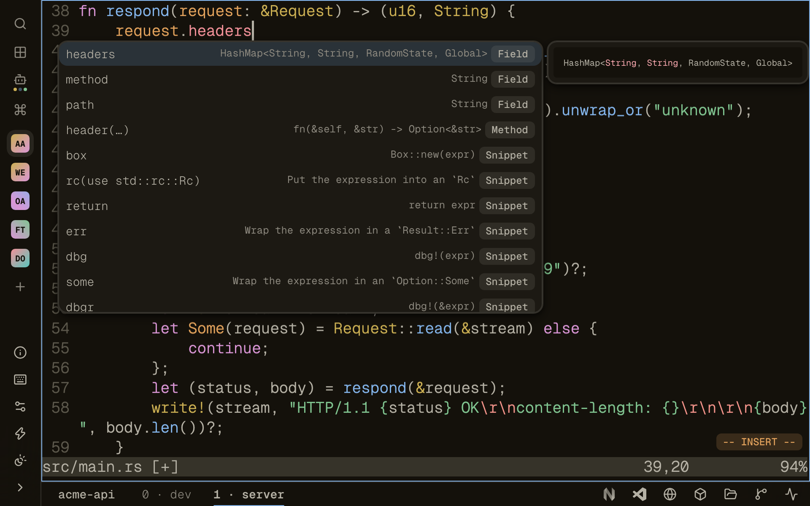
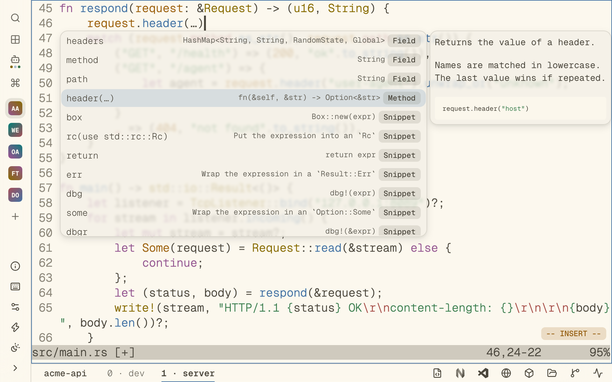
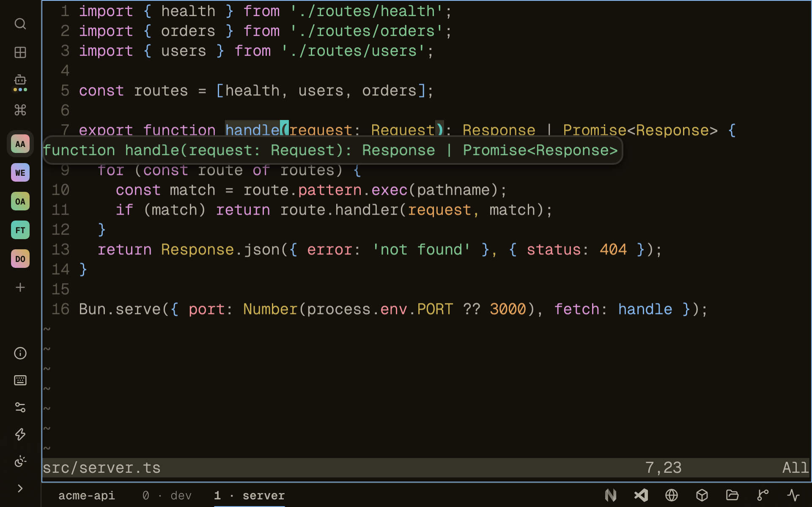
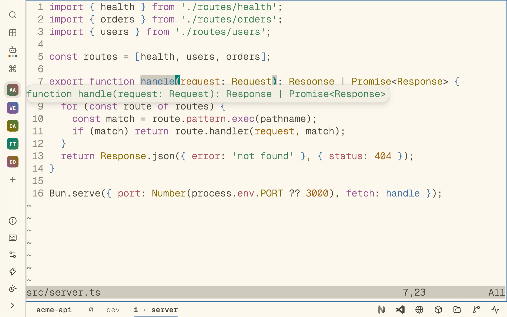
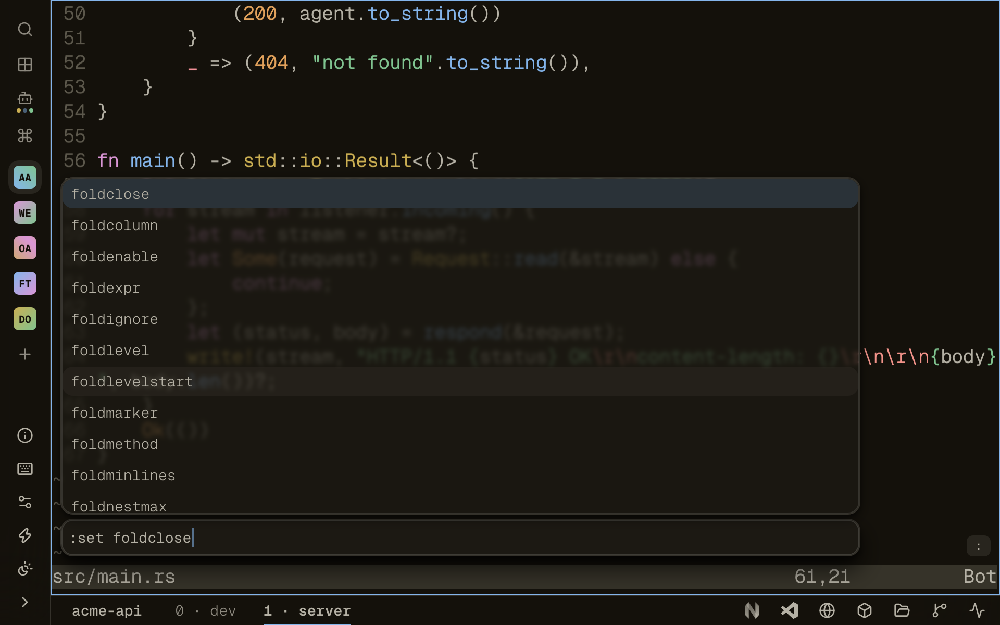
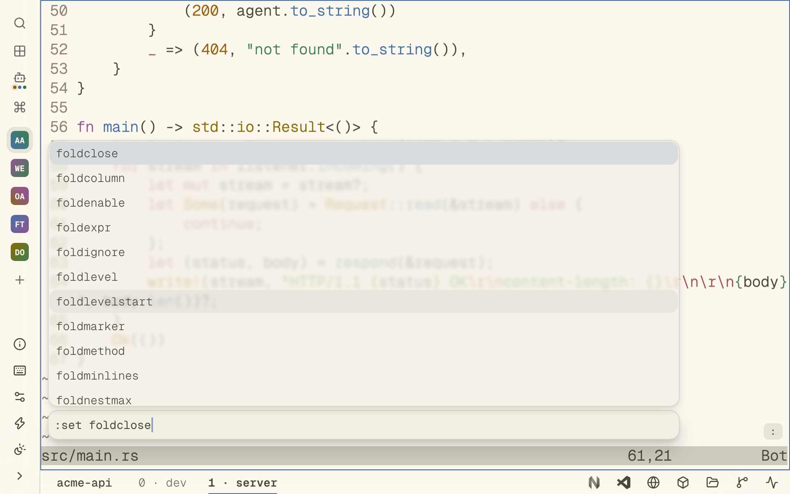

Set `editor = "neovim"` to open the Neovim GUI
[over the active pane](editors.md#over-a-pane) with `<prefix> + e`. The file
browser and Git mode open files there. btmux draws the command line,
completion menu, messages, progress, and LSP signature help in the GUI.
Floating windows appear as cards.










The GUI requires `nvim` 0.12 or newer on the server's `PATH`. With Neovim
configured as your editor, open it from the status bar. You can also use
`editor-neovim` from the command palette. Use `:q` to quit Neovim.

`winblend` and `pumblend` make floating windows and the completion menu
translucent, as in the screenshots, blurring what's behind them by
`backdrop-blur` while their text stays sharp.

## Your Neovim config

btmux loads your Neovim config and sets `g:btmux` for GUI-specific settings.

```lua
if vim.g.btmux then
  -- btmux animates each scroll; single-line steps feel smoothest
  vim.o.mousescroll = "ver:1,hor:6"
end
```

Plugins that draw their own completion menus or animate scrolling (such as
blink.cmp or snacks.nvim's `scroll`) keep working but bypass or fight btmux's UI.
Native completion goes through btmux's menu, including item docs:

```lua
if vim.g.btmux then
  vim.o.autocomplete = true
  vim.o.completeopt = "menuone,noselect,fuzzy,popup"
  vim.api.nvim_create_autocmd("LspAttach", {
    callback = function(ev)
      vim.lsp.completion.enable(true, ev.data.client_id, ev.buf, { autotrigger = true })
    end,
  })
end
```

## The btmux plugin

btmux bundles a Neovim plugin and loads it automatically. Call `setup` in your
config to change its defaults:

```lua
require("btmux").setup({
  completion_docs = true, -- item docs beside the completion menu
  signature = { keymap = "<C-s>" }, -- LSP signature help; false to disable
  progress = true, -- LSP, :write, and other progress as cards
  kind_icons = true, -- completion kind icons from mini.icons
  cmd_keys = true, -- <D-c>/<D-x> copy/cut a selection, <D-s> writes (unless you map them)
  check = true, -- warn once at startup about conflicts
})
```

`:checkhealth btmux` lists plugins and settings that conflict with btmux's UI:
noice.nvim, ui2, a replaced `vim.notify`, fidget.nvim, lsp_signature.nvim or
blink.cmp signature help, animated scrolling, an empty `'mouse'`, and a missing
clipboard provider. When it finds any, a toast points to it after the first view
attaches.

## Fonts, scrolling, and keys

The Neovim GUI uses btmux's selected Base16/24 palette through the bundled
`btmux` colorscheme. It applies when the GUI opens and follows live theme changes,
including session-only color overrides. btmux applies its colorscheme after your config loads. Customize highlights
with `ColorScheme` autocmds.

The default background follows `[terminal] allow-transparency`, which defaults
to enabled with a wallpaper or shader. Explicit highlight backgrounds (selection,
search, floats, and cursor line) remain visible. The pane underneath keeps running
while the editor covers it.

The view uses the terminal font and `font-weight` (bold is 700). Neovim's
`guifont` and `linespace` override it, as in Neovide: `:set guifont=Fira\ Code:h14`
sets the size in points, `:b` and `:i` make all text bold or italic, and `:w1`
widens cells by a point. Fonts with ligatures join them. Box-drawing and block
characters are drawn to the cell edges, so lines connect even with `linespace`.

Scrolling animates for `[terminal] smooth-scroll-duration` (default 120 ms);
scrolls of a whole window or more slide in their last line. Cursor moves animate
for `[terminal] cursor-animation-duration` (default 120 ms), except a cell or
two along the line. `animations = false` turns both off. The cursor blinks as
`guicursor` says, and is an outline while the view doesn't have focus. Focus
changes trigger `FocusGained` and `FocusLost`.

F-keys and Cmd shortcuts reach Neovim as `<F5>` or `<D-s>`. Cmd+Q, W, T, N, R,
L, M, H, Cmd+digits, and Cmd+V (paste) stay with the browser or desktop app.
With `mousemoveevent` set, hovering sends `<MouseMove>`; `mousehide` hides the
pointer while you type. Ctrl+Z (`:suspend`) hides the view, and a bell (when
`belloff` allows it) flashes it.

## Limitations

- Neovim sizes its grid to the smallest view attached to it.
- Plugins that draw a border as a separate window get a card around each window.
- `"+` registers use the clipboard of the machine btmux runs on.
