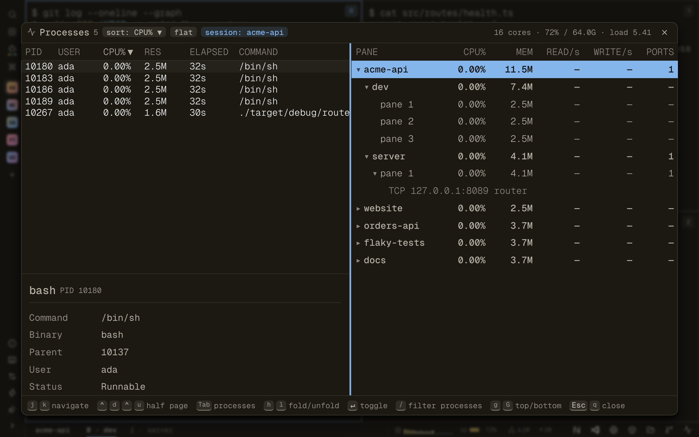

`<prefix> + t` shows what is running on the server and what it costs: every
process and listening port, and how much CPU, memory, and disk each session,
window, and pane is using. Use it to find the dev server holding a port, or
the pane whose build is eating the machine.

It has two sides: a list of processes or ports, and usage per pane. It
refreshes once a second.

| Key                     | Action                                              |
| ----------------------- | --------------------------------------------------- |
| `Tab`                   | Switch between the list and per-pane usage          |
| `p`                     | Switch the list between processes and ports         |
| `j` / `k`, arrows       | Move                                                |
| `g` / `G`               | First / last row                                    |
| `h` / `l`, Left / Right | Collapse / expand a process tree or a port's sockets |
| `Enter`, `Space`        | Toggle the same                                     |
| `/`                     | Filter                                              |
| `s`                     | Next sort order; a click on a column header sorts by it |
| `V`                     | Show processes flat or as a tree                    |
| `F`                     | Follow the selected row as the list reorders        |
| `x` / `X`               | Terminate / kill the process (asks first)           |
| `q`, `Esc`              | Close; Esc first clears a filter                    |

## Ports

Listening TCP ports come first, then everything else by port number. Click the
PORT header to sort by number alone, or **Listeners first** to go back.

- Sockets are grouped by local port and process. Expand a group for its
  sockets and their remote endpoints.
- A UDP socket marked `BOUND` has a local port. That doesn't mean a service is
  listening on it.
- A socket whose process is unknown can't be signaled. On macOS, sockets of
  processes btmux isn't allowed to inspect can be missing altogether.

## Per-pane usage

The usage side groups processes by session, window, and pane, and sums their
CPU (100% is one core), memory, disk reads and writes, and listening ports.
Sessions start folded.

Focus a row there and the list shows only that row's processes and ports,
until Esc clears it.

A process counts for the pane whose shell started it. A daemon that detaches
from its shell counts for no pane, as do the built-in editors and browser.
Programs in [sandboxed sessions](sandbox.md), and on Windows in Git Bash and
WSL panes, aren't counted.
