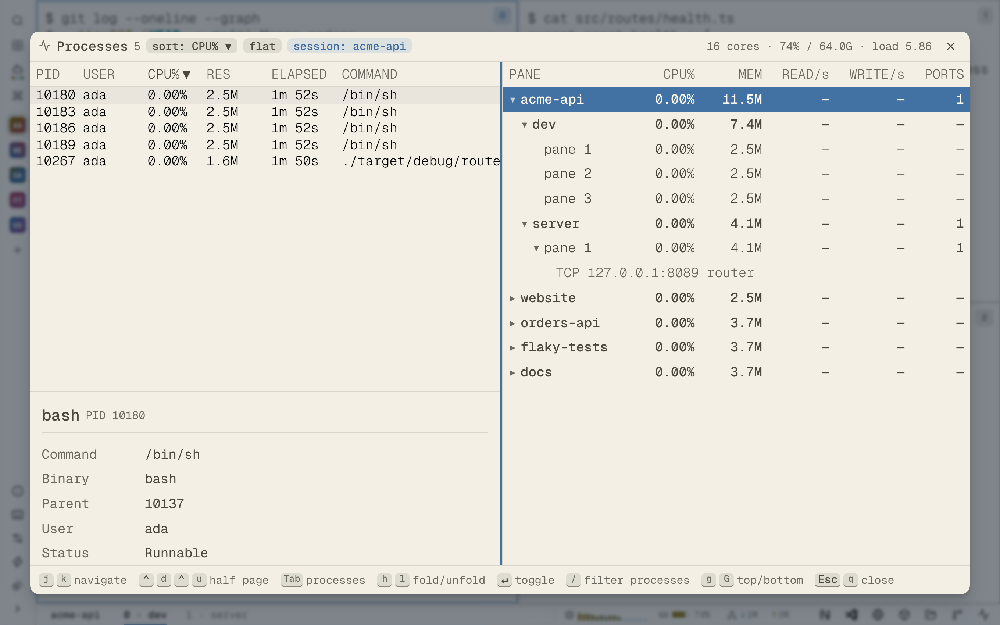

`<prefix> + t` shows what is running on the server and what it costs: every
process and listening port, and how much CPU, memory, and disk each session,
window, and pane is using. Use it to find the dev server holding a port, or
the pane whose build is eating the machine.

It has two sides, the process or port list and per-pane usage, and `Tab`
switches between them. Its keys work without the prefix:

| Key | Action |
| --- | --- |
| `p` | Switch between processes and ports |
| `j` / `k`, arrows | Move between rows |
| `g` / `G` | Move to the first / last row |
| `h` / `l`, left / right | Collapse / expand a process tree or port's socket details |
| `Tab` | Switch between the list and per-pane usage |
| `Enter`, `Space` | Toggle expansion |
| `/` | Filter by socket fields or process details; `Enter` / `Esc` clears the filter |
| `s` | Cycle sort modes; column headers select a sort directly |
| `F` | Follow the selected process or port group as rows reorder |
| `V` | Switch between flat and tree process views |
| `x` / `X` | Request termination / force kill, then confirm with `y` or cancel with `n` / `Esc` |
| `q` / `Esc` | Close the viewer (`Esc` first clears a filter or cancels confirmation) |

Ports initially sort with TCP listeners first, then by ascending port within
each category. All connections and UDP sockets remain visible. Choose the PORT
header for numeric sorting, or **Listeners first** to restore the initial order.
UDP `BOUND` means a socket has a local port; it does not identify a listening
service. While filtering, `p` is filter text rather than a mode switch.

Known owners group by local port and PID, with individual sockets and remote
endpoints available on expansion. Unknown owners group by protocol and local
and remote endpoints; matching endpoints do not establish a shared process
owner. Rows without process information cannot be signaled.

The viewer samples once per second. Port enumeration runs independently for
each viewer only while its ports view is open. Permissions can limit visibility:
on macOS, sockets belonging to inaccessible processes may be omitted entirely.

## Per-pane usage

The usage side groups processes by session, window, and pane, and sums their
CPU (100% is one core), memory, disk reads and writes, and listening ports.
Sessions start folded.

Focus a row there and the list shows only that row's processes and ports,
until Esc clears it.

A process counts for the pane whose shell started it. A daemon that detaches
from its shell counts for no pane, as do the built-in editors and browser.
Programs in [sandboxed sessions](sandbox.md), and on Windows in Git Bash and
WSL panes, aren't counted.
