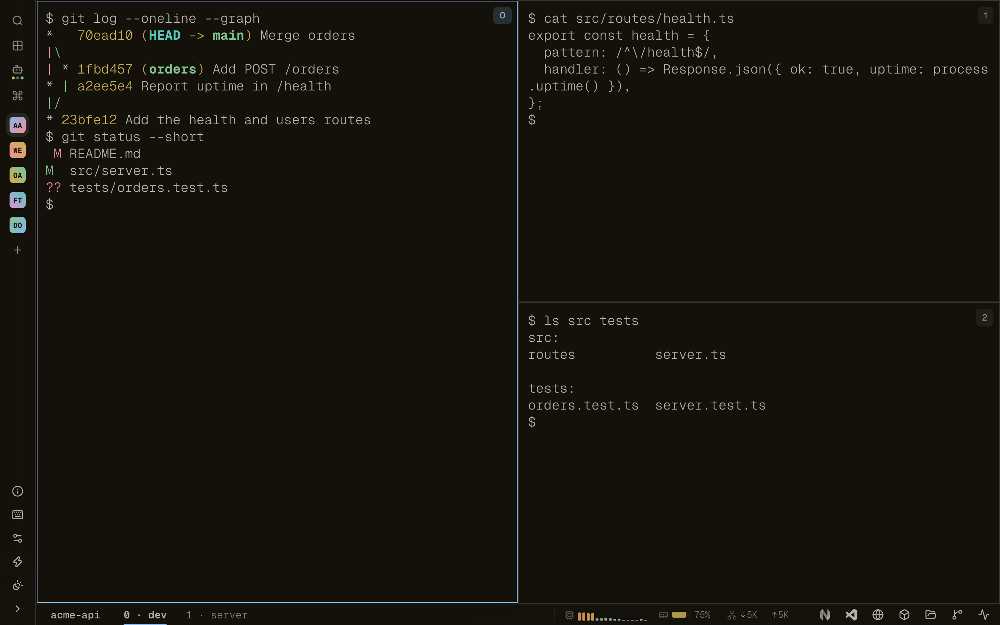
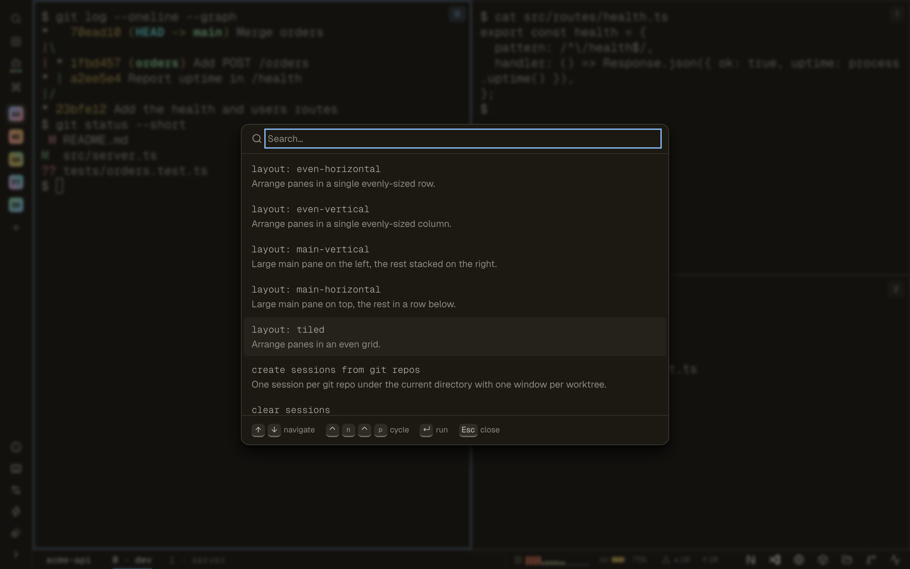
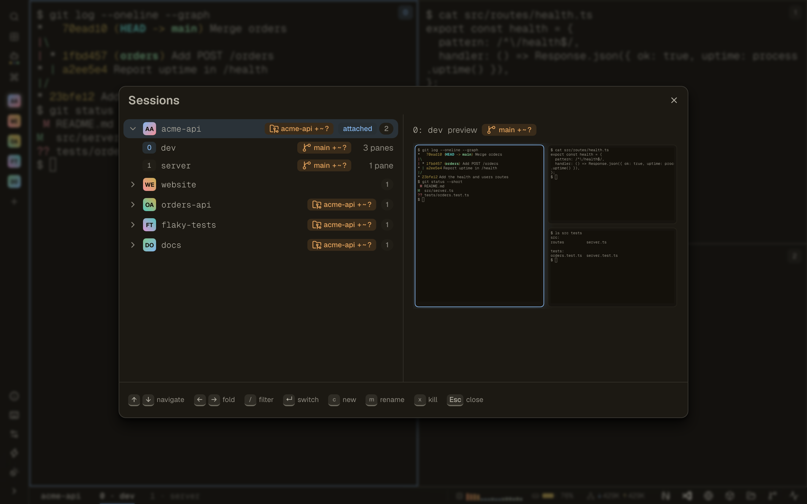

btmux opens with one session, one window, and one pane running your shell.
Everything else starts with the **prefix**: press `Ctrl+A`, release, then
press a key. Below, `<prefix> + %` means exactly that.

Two keys are worth remembering first:

- `<prefix> + ?` lists every key binding.
- `<prefix> + :` opens the command palette. Type to filter, Enter to run.

## Panes

A window is split into panes, each with its own shell.

| Key                 | Action                                      |
| ------------------- | ------------------------------------------- |
| `<prefix> + %`      | Split left and right                        |
| `<prefix> + "`      | Split top and bottom                        |
| `<prefix> + Arrow`  | Move to the pane in that direction          |
| `<prefix> + z`      | Zoom the pane to fill the window, and back  |
| `<prefix> + Space`  | Cycle through layouts                       |
| `<prefix> + x`      | Close the pane (asks first)                 |

The mouse works too: click a pane to focus it, and drag a divider to resize.
From the keyboard, `<prefix> + Ctrl+Arrow` resizes by one cell and
`<prefix> + Alt+Arrow` by five.

If a program needs `Ctrl+A` itself, such as readline's start-of-line, press it
twice. Or [change the prefix](../configuration/keybindings.md).

## Windows

Windows are like tabs. The status bar at the bottom lists them.

| Key                    | Action                               |
| ---------------------- | ------------------------------------ |
| `<prefix> + c`         | New window                           |
| `<prefix> + n` / `p`   | Next / previous window               |
| `<prefix> + 0`-`9`     | Go to a window by number             |
| `<prefix> + ,`         | Rename the window                    |
| `<prefix> + &`         | Close the window (asks first)        |
| `<prefix> + w`         | Window grid: live thumbnails of recent windows, from every session |

## Sessions

A session is a group of windows, usually one per project. Sessions live on the
server: close the app or the browser tab and your shells keep running. Open
btmux again, from this machine or [another](../features/remote-access.mdx),
and they are as you left them.

| Key                  | Action                                         |
| -------------------- | ---------------------------------------------- |
| `<prefix> + C`       | New session                                    |
| `<prefix> + s`       | Session switcher                               |
| `<prefix> + (` / `)` | Previous / next session                        |
| `<prefix> + L`       | Back to the last session                       |
| `<prefix> + $`       | Rename the session                             |

The switcher shows sessions and their windows as a tree, with a live preview.
`/` filters by session, window, repository, or branch name; Enter switches; `c`
creates, `m` renames, and `x` kills the selected row.

## Scrolling, searching, copying

- Scroll with the wheel or trackpad, or `<prefix> + PageUp` / `PageDown`.
- `<prefix> + /` searches the scrollback. Enter jumps to the next older match,
  Shift+Enter to a newer one, and Esc closes it. The search ignores case
  unless the query has an uppercase letter.
- Select text with the mouse and copy as in any app. `<prefix> + ]` pastes the
  clipboard.
- Cmd-click a URL (Ctrl-click outside macOS) to open it.
- `<prefix> + [` opens the pane's scrollback in `$EDITOR`, for when you need
  more than a search.

## Beyond the terminal

Each of these opens over the active pane or as a dialog. Dialogs close with
Esc; the editor and browser hide with their key, or Esc twice quickly:

| Key              | Opens                                                    |
| ---------------- | -------------------------------------------------------- |
| `<prefix> + f`   | [File browser](../features/files-and-git.md)             |
| `<prefix> + g`   | [Git mode](../features/files-and-git.md#git-mode)        |
| `<prefix> + e`   | [Editor](../features/editors.md): Neovim or VS Code      |
| `<prefix> + b`   | [Browser](../features/browser.md)                        |
| `<prefix> + t`   | [Process and port viewer](../features/process-viewer.md) |
| `<prefix> + a`   | [Agent view](../agents/index.md)                         |

## Make it yours

Open Settings from the command palette (`config: open settings`) to change
colors, fonts, key bindings, and wallpapers with live previews. Everything is
also in a [config file](../configuration/index.md).

## Where next

- [How btmux works](how-it-works.md): the server, its clients, and what
  survives a restart.
- [Remote access](../features/remote-access.mdx): your sessions from a phone
  or another machine.
- [Coding agents](../agents/index.md): see which agent needs you.
- Coming from tmux? See [what differs](tmux.md).
