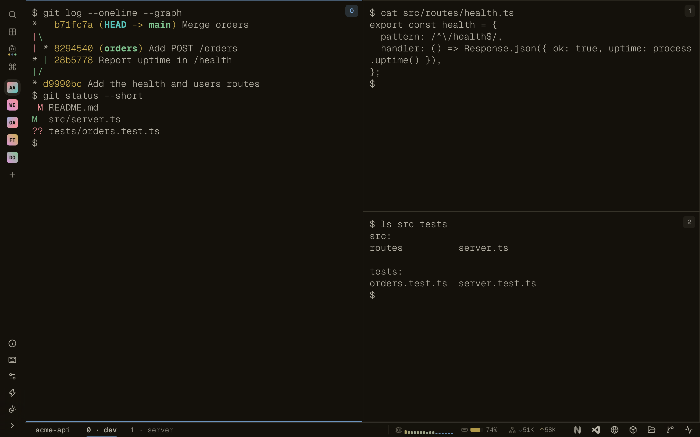
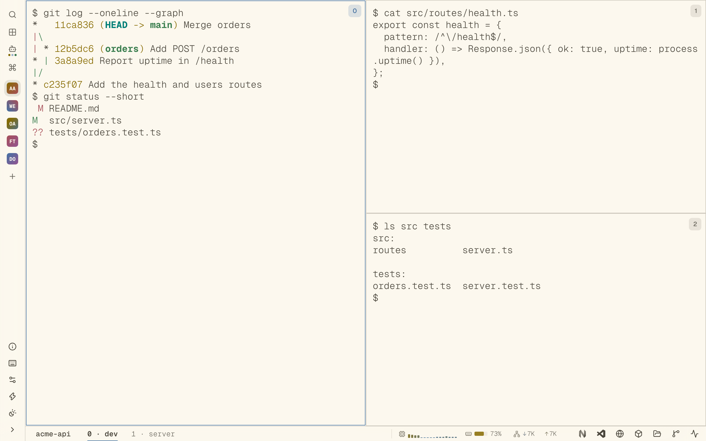
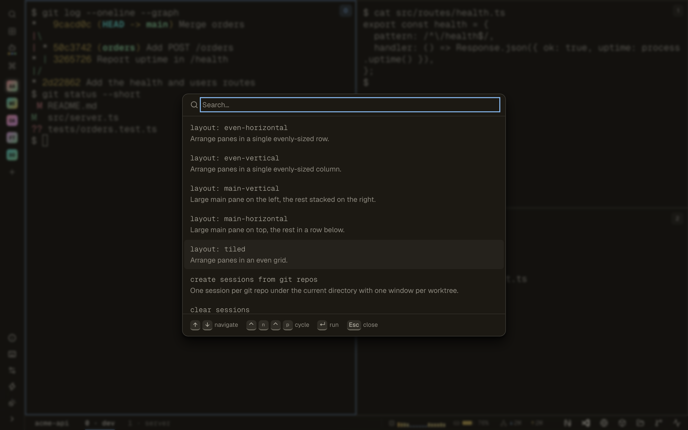
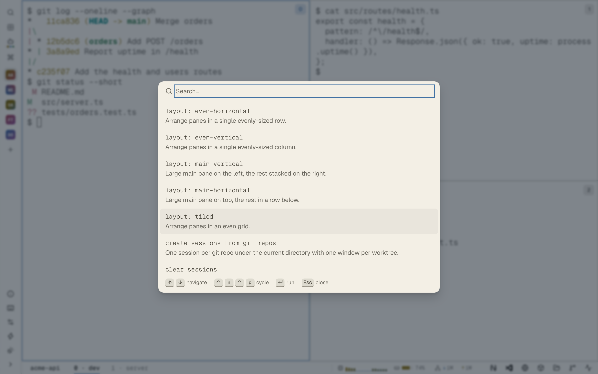
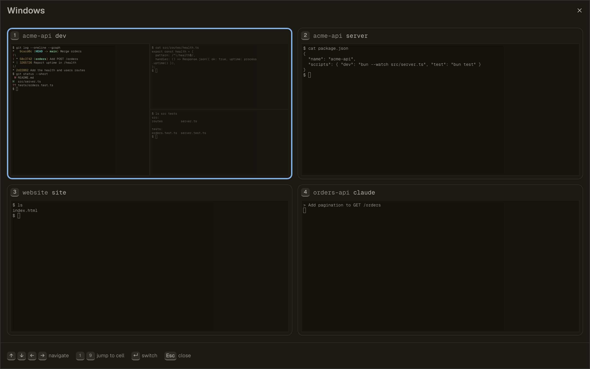
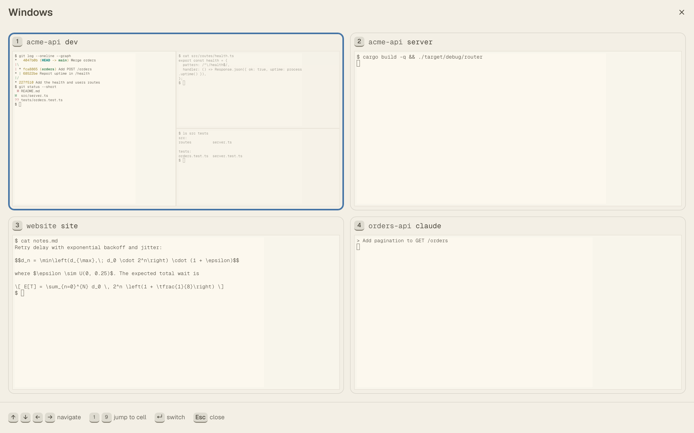
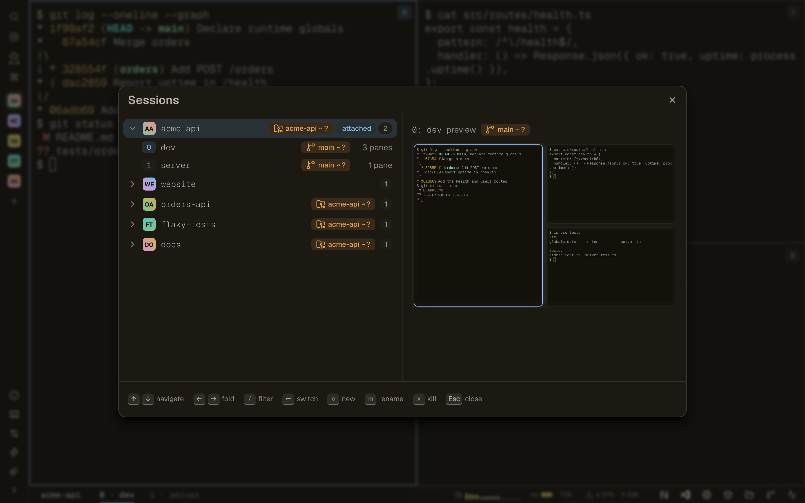
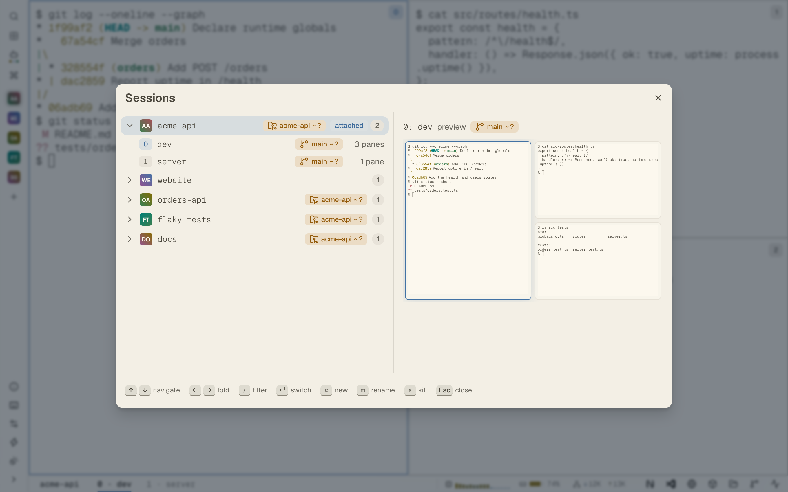

btmux opens with one session, one window, and one pane running your shell.

<btmux-demo name="panes" label="Demo: splitting panes, resizing, zooming, layouts, windows, the window grid, and the session picker"></btmux-demo>

## Split your first pane

1. Press `Ctrl+A`, release, then press `%`. A new shell opens to the right.
2. Type `echo hello` and press Enter. The output appears in the right pane.
3. Press `Ctrl+A`, release, then press the Left arrow. You can type in the
   original shell again while the output stays visible on the right.

`Ctrl+A` is the default **prefix**. In the shortcuts below, `<prefix> + %`
means the sequence you used in step 1.

- `<prefix> + ?` lists every key binding.
- `<prefix> + :` opens the command palette. Type to filter, Enter to run.

## Panes

| Key                 | Action                                      |
| ------------------- | ------------------------------------------- |
| `<prefix> + %`      | Split left and right                        |
| `<prefix> + "`      | Split top and bottom                        |
| `<prefix> + Arrow`  | Move to the pane in that direction          |
| `<prefix> + z`      | Zoom the pane to fill the window, and back  |
| `<prefix> + Space`  | Cycle through layouts                       |
| `<prefix> + x`      | Close the pane (asks first)                 |

Click a pane to focus it. Drag a divider to resize, or use
`<prefix> + Ctrl+Arrow` for one cell and `<prefix> + Alt+Arrow` for five.

Press the [prefix](../configuration/keybindings.md) twice to send it to the shell.

## Windows

Switch windows from the status bar or with these keys.

| Key                    | Action                               |
| ---------------------- | ------------------------------------ |
| `<prefix> + c`         | New window                           |
| `<prefix> + n` / `p`   | Next / previous window               |
| `<prefix> + 0`-`9`     | Go to a window by number             |
| `<prefix> + ,`         | Rename the window                    |
| `<prefix> + &`         | Close the window (asks first)        |
| `<prefix> + w`         | Window grid: live thumbnails of recent windows, from every session |

## Sessions

Group a project's windows in one session. Shells stay running when you close
a browser tab. To keep shells running after the desktop app quits, choose
[**Keep it running after btmux quits**](desktop.md#keeping-shells-running)
when starting its server.

| Key                  | Action                                         |
| -------------------- | ---------------------------------------------- |
| `<prefix> + C`       | New session                                    |
| `<prefix> + s`       | Session switcher                               |
| `<prefix> + (` / `)` | Previous / next session                        |
| `<prefix> + L`       | Back to the last session                       |
| `<prefix> + $`       | Rename the session                             |

In the switcher, press `/` to filter by session, window, repository, or branch.
Enter switches to the selected row. Use `c` to create, `m` to rename, or `x`
to close.

## Scrolling, searching, copying

- Scroll with the wheel or trackpad, or `<prefix> + PageUp` / `PageDown`.
- `<prefix> + /` searches the scrollback. Enter jumps to the next older match,
  Shift+Enter to a newer one, and Esc closes it. The search ignores case
  unless the query has an uppercase letter.
- Select text with the mouse and copy as in any app. `<prefix> + ]` pastes the
  clipboard.
- Cmd-click a URL (Ctrl-click outside macOS) to open it.
- `<prefix> + [` opens the pane's scrollback in the
  [configured editor](../features/editors.md#capturing-a-pane).

## Beyond the terminal

Press Esc to close a dialog. To hide the editor or browser, press its key
again or press Esc twice quickly.

| Key              | Opens                                                    |
| ---------------- | -------------------------------------------------------- |
| `<prefix> + f`   | [File browser](../features/files-and-git.md)             |
| `<prefix> + g`   | [Git mode](../features/files-and-git.md#git-mode)        |
| `<prefix> + e`   | [Editor](../features/editors.md)                         |
| `<prefix> + b`   | [Browser](../features/browser.md)                        |
| `<prefix> + t`   | [Process and port viewer](../features/process-viewer.md) |
| `<prefix> + a`   | [Agent view](../agents/index.md)                         |

## Make it yours

Open Settings from the command palette (`config: open settings`) to change
colors, fonts, key bindings, and wallpapers with live previews. Everything is
also in a [config file](../configuration/index.md).

## Where next

- [What survives a restart](how-it-works.md#what-survives)
- [Connect from another device](../features/remote-access.mdx)
- [Track coding agents](../agents/index.md)
- [Compare btmux and tmux](tmux.md)
